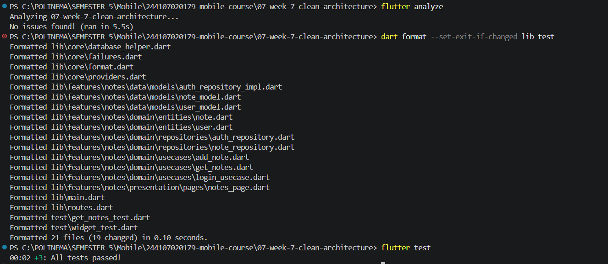

# Week 8 - Mid-Project Review

**Nama:** M. Aldyth Rafiansyah Fauzi \
**NIM:** 244107020179 \
**Kelas:** TI - 3G

## Tujuan Pembelajaran

Setelah menyelesaikan codelab ini, saya dapat:

- menjelaskan Git Flow dan strategi branching (`main`, `develop`, `feature/*`, `fix/*`);
- menulis commit dan Pull Request yang berkualitas dan mudah direview;
- melakukan peer code review yang konstruktif dengan checklist terstruktur;
- menjalankan static analysis dan formatter (`flutter analyze`, `dart format`) hingga bersih;
- menilai kesiapan project tengah semester dan menindaklanjuti hasil review;
- memverifikasi saran review dari AI sebelum diterapkan.

## Konsep Singkat

Git Flow membantu tim mengatur alur perubahan kode. Branch `main` berisi versi stabil, sedangkan `develop` menjadi tempat integrasi fitur. Perubahan baru dikerjakan pada branch `feature/*`, sedangkan perbaikan bug dapat dikerjakan pada branch `fix/*`, kemudian diajukan melalui Pull Request.

Commit yang baik menjelaskan perubahan secara spesifik dan mengikuti pola Conventional Commits. Pull Request sebaiknya berukuran kecil, memiliki tujuan yang jelas, serta menyertakan hasil pengujian agar mudah diperiksa oleh reviewer.

Peer review dilakukan dengan checklist agar reviewer tidak hanya memberikan persetujuan secara otomatis. Review perlu memeriksa kebenaran logika, arsitektur, pengujian, keterbacaan, dan dampak perubahan. Saran dari AI juga harus diverifikasi terhadap kode dan hasil pengujian sebelum diterapkan.

## Praktikum 1: Review Hygiene Commit dan Branch

Audit riwayat commit Minggu 5-7 menunjukkan bahwa beberapa commit masih menggunakan judul yang terlalu umum, seperti `Menyelesaikan Week 6` dan `Menyelesaikan Jobsheet 7`. Judul tersebut diperjelas menggunakan Conventional Commits agar tujuan perubahan lebih mudah dipahami.

| Commit Lama                              | Commit Baru                                                                | Alasan Perubahan                                                                 |
| :--------------------------------------- | :------------------------------------------------------------------------- | :------------------------------------------------------------------------------- |
| `Week 5 Local Storage dan Offline-First` | `feat(storage): tambah fitur penyimpanan lokal dan offline-first`          | Menjelaskan penambahan fitur penyimpanan lokal dengan tipe dan scope yang jelas. |
| `Menyelesaikan Week 6`                   | `feat(auth): tambah autentikasi dan integrasi fcm week 6`                  | Menjelaskan fitur autentikasi dan integrasi FCM yang dikerjakan.                 |
| `Menyelesaikan Jobsheet 7`               | `feat(architecture): implementasi clean architecture pada aplikasi week 7` | Menjelaskan perubahan arsitektur yang dilakukan.                                 |

Branch untuk perubahan dibuat dari `develop`. Pull Request dijaga tetap kecil dan fokus pada satu fitur atau refactor, serta issue ditutup otomatis melalui PR.

## Praktikum 2: Peer Code Review

### Ringkasan Pull Request

- **Judul PR:** `feat(notes): validasi judul kosong + test (#1)`
- **Issue:** `#4 - Validasi Input Judul Kosong pada Fitur Notes`
- **Branch:** `feature/notes-validation` -> `develop`
- **Status:** Approved & Merged

### Temuan Review

1. **Null dan edge case:** validasi perlu menangani nilai `null` sebelum memanggil `trim()` agar tidak terjadi `NoSuchMethodError`.
2. **Arsitektur:** logika validasi sebaiknya dipindahkan dari Widget UI ke `ValidateNoteUseCase` agar dapat diuji tanpa bergantung pada UI.
3. **Test dan keterbacaan:** perlu ditambahkan test untuk input yang hanya berisi spasi, misalnya `"   "`.

Ketiga komentar tersebut menunjukkan bahwa review tidak hanya memeriksa apakah aplikasi dapat berjalan, tetapi juga memeriksa potensi error, pemisahan tanggung jawab, dan kelengkapan pengujian.

## Praktikum 3: Checklist Kesiapan Mid-Project

- [x] Branch dibuat dari `develop` dan Pull Request dibuat untuk perubahan yang terfokus.
- [x] Minimal tiga komentar review bermakna telah ditindaklanjuti hingga mendapat `Approve`.
- [x] `flutter analyze` selesai tanpa issue.
- [x] `dart format` selesai dengan format yang rapi.
- [x] `flutter test` berhasil dan seluruh test lulus.
- [x] Workflow CI pada `.github/workflows/ci.yml` ditambahkan untuk memeriksa kualitas Pull Request.
- [x] Perbandingan saran AI dan keputusan akhir didokumentasikan di `docs/AI_Challenge.md`.

## Praktikum 4: Verifikasi Review dari AI

Tidak semua saran AI langsung diterapkan. Setiap temuan dibandingkan dengan kode, hasil test, dan prinsip Clean Architecture.

| Temuan AI                                                    | Level   | Keputusan | Alasan                                                                |
| :----------------------------------------------------------- | :------ | :-------- | :-------------------------------------------------------------------- |
| Error handling pada repository belum mengembalikan `Failure` | Blocker | Diterima  | Terbukti melalui test simulasi kegagalan database.                    |
| Resource async pada provider berpotensi tidak dibersihkan    | Saran   | Diterima  | `ref.onDispose()` digunakan untuk membersihkan subscription.          |
| Mengimpor Dio atau SQLite langsung ke layer domain           | Blocker | Ditolak   | Melanggar Dependency Rule Clean Architecture.                         |
| Use case belum menguji skenario error atau empty list        | Blocker | Diterima  | Coverage sebelumnya hanya mencakup happy path.                        |
| Mengubah gaya penamaan variabel lokal                        | Saran   | Ditolak   | Tidak memberi dampak fungsional dan sudah ditangani formatter/linter. |

## Dokumentasi Screenshot

### Pemeriksaan Static Analysis, Formatting, dan Test

> Bukti pemeriksaan kualitas Flutter yang digunakan sebagai acuan sebelum dan sesudah proses review.

Dokumentasi lebih rinci mengenai checklist, peer review, dan verifikasi AI tersedia pada folder `docs/`:

- [Review checklist](docs/review-checklist.md)
- [Laporan peer review](docs/peer-review.md)
- [AI Challenge](docs/AI_Challenge.md)

## Refleksi

1. **Apa beda LGTM buta dengan approve yang bertanggung jawab? Apa risikonya bagi tim?**  
   LGTM buta hanya menyetujui perubahan tanpa memeriksa kode, test, dan dampaknya. Approve yang bertanggung jawab diberikan setelah reviewer memahami perubahan dan memastikan checklist terpenuhi. LGTM buta dapat meloloskan bug, celah keamanan, atau pelanggaran arsitektur ke branch bersama.

2. **Kapan komentar wajib berstatus _request changes_, dan kapan cukup saran?**  
   `Request changes` digunakan untuk masalah yang dapat menyebabkan bug, crash, kegagalan test, celah keamanan, atau pelanggaran aturan arsitektur yang penting. Komentar cukup menjadi saran jika hanya menyangkut keterbacaan, alternatif implementasi, atau penyempurnaan yang tidak menghalangi perubahan untuk digabungkan.

3. **Bagian mana dari review AI yang saya tolak atau sederhanakan, dan mengapa?**  
   Saya menolak saran untuk mengimpor Dio atau SQLite langsung ke layer domain karena melanggar Dependency Rule Clean Architecture. Saya juga menolak saran perubahan gaya penamaan variabel karena tidak memberi dampak fungsional dan sudah ditangani oleh `dart format` serta `flutter analyze`.

4. **Satu hal konkret yang Anda perbaiki setelah review sejawat - apa dampaknya?**  
   Saya memperbaiki validasi judul catatan agar menangani nilai kosong, `null`, dan input yang hanya berisi spasi, lalu menambahkan test untuk edge case tersebut. Dampaknya, aplikasi menjadi lebih tahan terhadap input tidak valid dan potensi error pada saat runtime berkurang.
