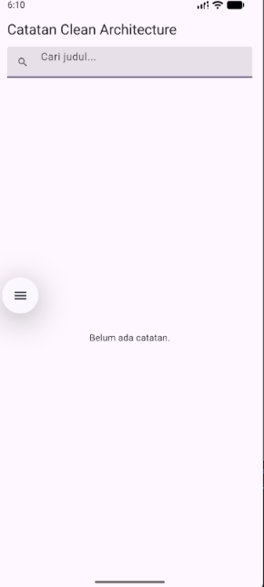

# Week 9 - AI-Assisted Development

**Nama:** M. Aldyth Rafiansyah Fauzi  \
**NIM:** 244107020179  \
**Kelas:** TI - 3G

## Tujuan Pembelajaran

Setelah menyelesaikan codelab ini, mahasiswa mampu:

- menjelaskan workflow AI-assisted development, yaitu prompt, generate, verify, test, refactor, dan explain;
- menulis prompt serta konteks yang efektif untuk fitur Flutter kecil;
- mengenali halusinasi dan keterbatasan AI pada kode Flutter;
- melakukan debugging dan refactoring kode hasil AI ke Clean Architecture;
- menguji kode hasil AI dengan `flutter analyze` dan test;
- mendokumentasikan prompt, hasil AI, keputusan terima/tolak, dan bukti uji di [`docs/ai-log.md`](docs/ai-log.md).

## Konsep Singkat

AI-assisted development menggunakan AI sebagai alat bantu, bukan sebagai pengganti proses verifikasi developer. Alurnya dimulai dari prompt yang memiliki peran, konteks, tugas, batasan, dan format output. Kode yang dihasilkan kemudian harus dibaca, dibandingkan dengan API project, diuji, dan direfactor jika belum sesuai arsitektur.

Pada praktikum ini, fitur yang dikembangkan adalah pencarian catatan berdasarkan judul dan empty state ketika hasil pencarian tidak ditemukan. Fitur tetap mengikuti arsitektur feature-first dengan alur dependensi `presentation -> domain <- data`.

## Praktikum 1: Prompt dan Output AI

Prompt dibuat dengan lima bagian utama:

1. **Peran:** AI diminta bertindak sebagai senior Flutter developer.
2. **Konteks:** Project menggunakan feature-first, Riverpod, SQLite, dan Dio.
3. **Tugas:** Menambahkan pencarian berdasarkan judul dan empty state.
4. **Batasan:** Tidak mengubah layer, tidak mengakses SQLite/Dio dari widget, perubahan maksimal 80 baris, dan tidak menggunakan secret.
5. **Output:** Kode, test, dan cara menjalankan test.

Output awal AI mengusulkan `StateProvider` dan fungsi `filterNotes`. Keduanya perlu diverifikasi karena belum tentu tersedia pada versi package dan kontrak project yang digunakan.

## Praktikum 2: Verifikasi dan Deteksi Halusinasi

Hasil verifikasi menunjukkan bahwa `StateProvider` tidak tersedia pada export utama `flutter_riverpod` versi 3.4.3. API tersebut berada pada `legacy.dart`, sedangkan `filterNotes(...)` juga tidak ada pada kontrak project.

Halusinasi tersebut dibuktikan dengan:

- pemeriksaan source code dan export package;
- error analyzer: `The function 'StateProvider' isn't defined.`;
- pencocokan nama fungsi dengan kontrak repository dan kode yang benar-benar ada.

Perbaikannya adalah mengganti state query dengan `NotifierProvider<SearchQueryNotifier, String>` dan menyesuaikan pemanggilan filter dengan use case `SearchNotes`.

## Praktikum 3: Debugging dan Refactoring

Bug ditemukan ketika query memiliki spasi berlebih, misalnya `belanja  mingguan`. Filter hanya melakukan `trim()` dan `toLowerCase()`, sehingga dua spasi di tengah query tidak cocok dengan judul `Belanja Mingguan`.

Perbaikannya dilakukan pada use case domain `SearchNotes` dengan normalisasi whitespace menjadi satu spasi sebelum proses pencarian. Filter kemudian diuji untuk query kosong, pencarian tanpa memperhatikan huruf besar-kecil, query yang tidak cocok, dan spasi berlebih.

Hasil refactor:

```text
Widget (UI) -> NotesListNotifier (state) -> SearchNotes (filter) -> NoteRepository (SQLite)
```

Widget hanya menampilkan daftar atau empty state. Logika pencarian berada di domain sehingga dapat diuji tanpa Flutter, database, atau jaringan. Race condition pada pencarian async juga diperbaiki dengan version guard agar hasil request lama tidak menimpa query terbaru.

## Keputusan Terima dan Tolak

| Saran AI | Keputusan | Alasan |
| :--- | :--- | :--- |
| Menambahkan perlindungan race condition pada search async | **Terima + refactor** | Version guard menjaga state tetap berasal dari request terbaru. |
| Menambahkan test untuk request yang selesai tidak berurutan | **Terima** | Test biasa belum membuktikan urutan penyelesaian Future. |
| Memindahkan filtering ke SQLite/API | **Tolak untuk scope ini** | Data masih lokal dan perubahan kontrak repository akan memperbesar scope. |
| Widget mengimpor detail framework atau storage untuk filtering | **Tolak** | Tidak sesuai dengan batas arsitektur `presentation -> domain <- data`. |

## Bukti Pengujian

Perintah verifikasi yang digunakan:

```powershell
flutter analyze
flutter test
flutter test test/search_filter_test.dart
flutter test test/empty_state_test.dart
```

Hasil yang dicatat:

- `flutter analyze`: tidak ada warning atau error;
- seluruh test: lulus `+14`;
- test pencarian: lulus `+4`;
- widget test empty state: lulus `+1`.

Dokumentasi prompt, output AI, bukti halusinasi, proses debugging, refactor, serta hasil pengujian tersedia di [`docs/ai-log.md`](docs/ai-log.md). Ringkasan review dan tabel keputusan teknis tersedia di [`docs/AI_Challenge.md`](docs/AI_Challenge.md).

## Dokumentasi Screenshot

### Empty State Pencarian

> Saat tidak ada catatan yang sesuai dengan pencarian, aplikasi menampilkan empty state `Belum ada catatan.`.



## Refleksi

1. **Satu halusinasi AI apa yang Anda temukan dan bagaimana membuktikannya?**  
	AI menyarankan `StateProvider` langsung dari export utama `flutter_riverpod`. Hal ini terbukti sebagai halusinasi karena API tersebut tidak tersedia pada export yang digunakan, analyzer menghasilkan error `The function 'StateProvider' isn't defined.`, dan `filterNotes(...)` juga tidak ditemukan di project.

2. **Prompt mana yang paling membantu dan apa yang Anda ubah?**  
	Prompt dengan lima slot paling membantu karena menjelaskan peran, konteks arsitektur, tugas, batasan, dan output yang diharapkan. Saya memperjelas kontrak repository, versi package, aturan layer, serta test yang harus dibuat agar jawaban AI lebih sesuai dengan project.

3. **Satu refactor apa yang Anda lakukan pada kode AI?**  
	Logika filter dipindahkan dari widget ke use case domain `SearchNotes`. Saya juga menambahkan normalisasi spasi dan mengganti `StateProvider` dengan `NotifierProvider` yang sesuai dengan Riverpod versi project.

4. **Keputusan terima/tolak mana yang paling sulit?**  
	Keputusan paling sulit adalah menolak saran memindahkan filtering ke SQLite/API. Saran tersebut masuk akal untuk data besar, tetapi belum diperlukan karena scope saat ini masih menggunakan data lokal dan kontrak repository belum mendukung query filtering.
