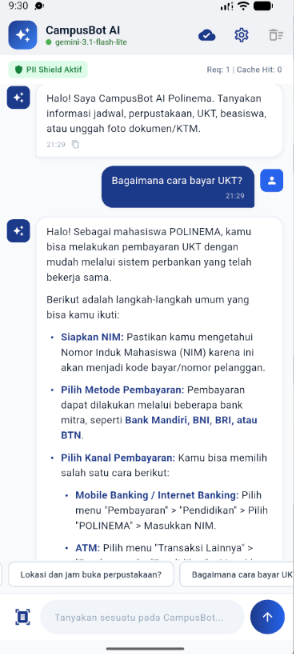
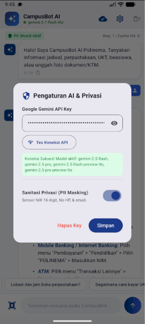

# Week 10 - Integrasi Fitur AI

**Nama:** M. Aldyth Rafiansyah Fauzi \
**NIM:** 244107020179 \
**Kelas:** TI - 3G

## Tujuan Pembelajaran

Setelah menyelesaikan codelab ini, mahasiswa mampu:

- memahami konsep integrasi LLM API ke aplikasi mobile;
- merancang chat interface dengan streaming response;
- mengintegrasikan OCR, Speech-to-Text, dan Image Understanding;
- menerapkan prompt design yang aman dan efektif;
- menangani privasi, biaya, error handling, dan fallback design;
- mengevaluasi pengalaman pengguna pada fitur AI.

## Konsep Singkat

Integrasi fitur AI pada aplikasi mobile membutuhkan lebih dari sekadar pemanggilan API. Developer perlu merancang prompt, mengatur tampilan chat, melindungi data pribadi, menghemat penggunaan API, menangani error, dan menyediakan fallback ketika layanan AI tidak dapat digunakan.

Pada praktikum ini, fitur yang dikembangkan adalah **CampusBot AI Polinema**. Aplikasi menggunakan Google Gemini untuk menjawab pertanyaan akademik, serta menyediakan sanitasi PII, cache lokal, analisis gambar/OCR, penyimpanan API key yang aman, dan knowledge base offline.

## Praktikum 1: Integrasi LLM API dan Chat Interface

CampusBot memiliki chat interface untuk mengirim pertanyaan kepada AI. Pengguna juga dapat menggunakan quick prompt untuk pertanyaan umum seperti jadwal kuliah, perpustakaan, UKT, dan beasiswa.

Respons AI ditampilkan pada gelembung chat dan status koneksi ditampilkan pada bagian aplikasi. Aplikasi membedakan respons dari model Gemini dengan respons dari mode offline sehingga pengguna mengetahui sumber jawaban yang diterima.

Alur fitur chat secara umum adalah:

```text
Input pengguna -> Sanitasi PII -> Cache -> Gemini API atau Offline Fallback -> Respons chat
```

## Praktikum 2: Prompt Design yang Aman dan Efektif

System prompt dibuat dengan beberapa komponen utama:

1. **Peran:** AI bertindak sebagai asisten kampus yang ramah dan profesional.
2. **Konteks:** AI membantu sivitas akademika Politeknik Negeri Malang.
3. **Bahasa:** Jawaban menggunakan Bahasa Indonesia yang santun, ringkas, dan jelas.
4. **Batasan keamanan:** AI tidak boleh meminta atau membocorkan data pribadi mahasiswa.
5. **Batasan informasi:** Pertanyaan di luar konteks kampus diarahkan ke layanan resmi yang relevan.

Contoh system prompt dan hasil pengujian prompt dicatat di [`docs/ai-log.md`](docs/ai-log.md). Prompt juga mengarahkan pengguna ke portal resmi kampus untuk informasi akademik yang bersifat formal agar jawaban AI tidak dijadikan satu-satunya sumber keputusan.

## Praktikum 3: OCR dan Image Understanding

Fitur multimodal digunakan untuk menganalisis gambar dokumen seperti KTM mahasiswa atau bukti pembayaran UKT. Hasil analisis dapat digunakan untuk mengekstrak teks dan membuat ringkasan informasi dari gambar.

Pengujian `understandImage` juga menyediakan hasil OCR simulasi sebagai fallback. Dengan demikian, alur aplikasi dapat diuji tanpa selalu bergantung pada layanan vision API atau koneksi internet.

Speech-to-Text menjadi bagian dari konsep pengembangan fitur AI mobile, sedangkan implementasi pada project ini difokuskan pada chat, OCR, dan image understanding.

## Praktikum 4: Privasi dan Keamanan Data

Input pengguna diperiksa di perangkat sebelum dikirim ke AI API. Data yang terdeteksi sebagai informasi pribadi diganti dengan token samaran berikut:

```text
[NIK_DISAMARKAN]
[NO_HP_DISAMARKAN]
[EMAIL_DISAMARKAN]
```

Data yang dilindungi meliputi NIK 16 digit, nomor telepon Indonesia, dan alamat email. API key tidak ditulis langsung di source code, tetapi disimpan menggunakan `flutter_secure_storage` agar tersimpan pada penyimpanan aman perangkat.

## Praktikum 5: Cache, Error Handling, dan Fallback

Pertanyaan yang sama disimpan pada cache lokal. Jika pengguna mengirim pertanyaan identik, aplikasi dapat memberikan respons dari cache tanpa mengirim request baru ke API. Cara ini membantu mengurangi penggunaan kuota dan mempercepat waktu respons.

Ketika API key belum diatur, koneksi internet terputus, terjadi timeout, atau layanan mengembalikan error seperti HTTP 429, aplikasi menggunakan **Offline Campus Knowledge Base**. Fallback ini menyediakan informasi umum tentang jadwal, perpustakaan, UKT, dan beasiswa sehingga aplikasi tidak crash atau menampilkan layar kosong.

## Keputusan Implementasi

| Solusi                                              | Keputusan  | Alasan                                                                              |
| :-------------------------------------------------- | :--------- | :---------------------------------------------------------------------------------- |
| Menggunakan Google Gemini sebagai LLM API           | **Terima** | Sesuai kebutuhan integrasi LLM dan mendukung respons teks serta multimodal.         |
| Menambahkan sanitasi PII sebelum request            | **Terima** | Data sensitif perlu dilindungi sebelum keluar dari perangkat.                       |
| Menyimpan API key langsung di source code           | **Tolak**  | Berisiko terekspos pada repository atau hasil decompile aplikasi.                   |
| Menggunakan cache untuk pertanyaan identik          | **Terima** | Mengurangi request berulang, biaya, dan waktu tunggu pengguna.                      |
| Mengandalkan API tanpa fallback                     | **Tolak**  | Aplikasi tetap harus dapat memberikan bantuan saat offline atau API error.          |
| Menjadikan jawaban AI sebagai sumber resmi akademik | **Tolak**  | Informasi formal tetap harus dikonfirmasi melalui portal atau layanan resmi kampus. |

## Bukti Pengujian

Perintah verifikasi yang digunakan:

```powershell
flutter analyze
flutter test
```

Hasil yang dicatat:

- `flutter analyze`: tidak ada warning atau error pada project Week 10;
- seluruh test: lulus `+7`;
- test sanitasi: NIK, nomor HP, dan email berhasil disamarkan;
- test fallback: informasi jadwal, perpustakaan, UKT, dan beasiswa berhasil ditampilkan;
- test cache: request identik menggunakan hasil cache;
- test OCR: analisis gambar menghasilkan deskripsi fallback;
- widget test: tampilan awal, mode offline, dan pembersihan chat berhasil diuji.

Dokumentasi system prompt, contoh input, output AI, sanitasi PII, OCR, dan fallback tersedia di [`docs/ai-log.md`](docs/ai-log.md).

## Dokumentasi Screenshot

### Chat dengan Respons Gemini API

> Aplikasi menampilkan interaksi chat CampusBot dengan respons yang berhasil diterima dari Google Gemini API. Indikator model `gemini-3.1-flash-lite` dan jumlah request menunjukkan bahwa aplikasi terhubung ke layanan AI.



### Pengaturan AI dan Privasi

> Pengguna dapat menyimpan API key Gemini secara aman, melakukan tes koneksi API, dan mengaktifkan perlindungan PII untuk menyamarkan NIK, nomor HP, dan email sebelum dikirim ke layanan AI.



## Refleksi

1. **Fitur AI mana yang Anda integrasikan dan mengapa?**  
   Saya mengintegrasikan CampusBot AI Polinema dengan fitur chat, OCR atau image understanding, cache, dan fallback offline. Fitur ini dipilih karena mahasiswa membutuhkan akses cepat terhadap informasi akademik seperti jadwal kuliah, perpustakaan, UKT, dan beasiswa dalam satu aplikasi.

2. **Bagaimana Anda melindungi privasi pengguna saat menggunakan AI API?**  
   Privasi dilindungi dengan melakukan sanitasi di sisi perangkat sebelum request dikirim ke API. NIK, nomor HP, dan email diganti dengan token samaran. API key disimpan menggunakan `flutter_secure_storage`, sedangkan system prompt melarang AI meminta atau membocorkan data pribadi mahasiswa.

3. **Fallback apa yang Anda sediakan jika layanan AI error?**  
   Saya menyediakan knowledge base lokal berbasis aturan untuk pertanyaan umum kampus. Fallback aktif ketika API key belum diatur, koneksi bermasalah, request timeout, atau kuota API habis. Dengan cara ini aplikasi tetap menampilkan informasi dan tidak mengalami crash.

4. **Satu hal yang Anda pelajari tentang UX fitur AI di mobile?**  
   Saya mempelajari bahwa feedback cepat dan status yang jelas sangat penting pada fitur AI mobile. Indikator proses, informasi mode online atau offline, cache, dan fallback membuat pengguna tetap memahami kondisi aplikasi ketika respons AI membutuhkan waktu atau layanan sedang bermasalah.
