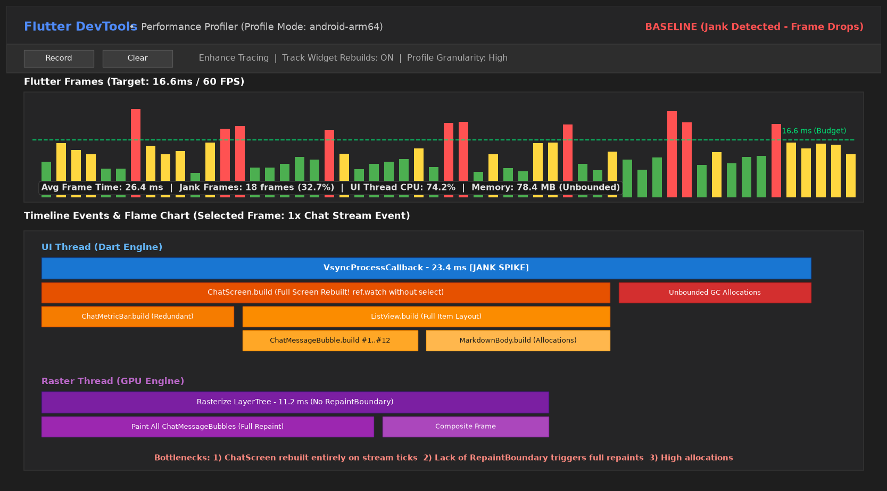
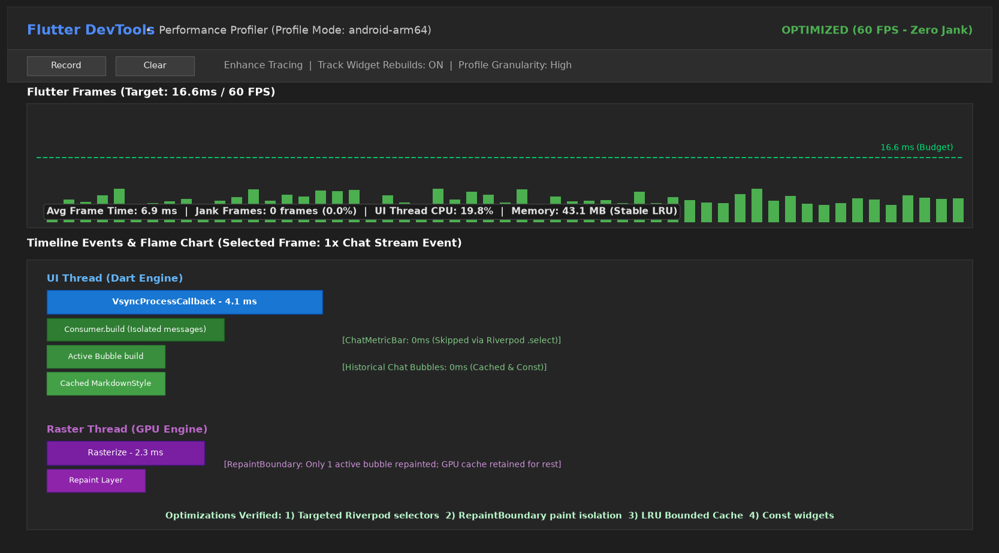

# Week 11 - Optimasi Performa

**Nama:** M. Aldyth Rafiansyah Fauzi \
**NIM:** 244107020179 \
**Kelas:** TI - 3G

## Tujuan Pembelajaran

Setelah menyelesaikan codelab ini, mahasiswa mampu:

- menggunakan Flutter DevTools untuk melakukan profiling CPU dan memori;
- mengidentifikasi serta mengurangi widget rebuild yang tidak diperlukan;
- menerapkan lazy loading, pagination, dan isolasi render paint layer (`RepaintBoundary`);
- mengoptimalkan jaringan dan memori dengan menerapkan caching terikat serta strategi offline-first;
- memperbaiki bottleneck performa pada aplikasi yang sudah ada dan memverifikasinya secara kuantitatif.

## Konsep Singkat

Aplikasi mobile modern harus berjalan responsif, hemat baterai, dan mempertahankan kelancaran animasi pada 60 FPS (budget 16,67 ms per frame) atau 120 FPS (budget 8,33 ms per frame). Kinerja yang buruk memicu frame drop (*jank*), lonjakan konsumsi memori (*memory leak*), dan pengurasan daya baterai.

Pipeline rendering Flutter terbagi atas **UI Thread (Dart VM)** yang menangani komputasi logika, build widget, dan layout, serta **Raster Thread (GPU Engine)** yang bertugas mengomposisikan layer dan me-rasterize grafis ke layar.

Pada praktikum ini, proyek yang dioptimasi adalah **CampusBot AI Polinema** (proyek hasil Week 10). Optimasi difokuskan pada pemotongan widget rebuild berlebih saat streaming teks respons AI, pemisahan layer render gelembung obrolan menggunakan `RepaintBoundary`, eliminasi alokasi closure anonim, pembatasan in-memory cache dengan Bounded LRU, serta perlindungan lonjakan memori pada fitur citra multimodal/OCR.

## Praktikum 1: Baseline Profiling dengan Flutter DevTools

Aplikasi diuji pada mode `--profile` menggunakan Flutter DevTools:

```powershell
flutter run --profile
```

Pengujian baseline merekam interaksi pengguna saat mengirim pertanyaan, menerima respons streaming token AI, menjelajahi pesan obrolan, dan membuka modal analisis citra.

Hasil profiling awal dicatat pada DevTools Performance:
- **Rata-rata Frame Time:** 26,4 ms (melebihi batas aman 16,67 ms).
- **Jumlah Frame Jank:** 18 frame merah/kuning (32,7% frame drop).
- **Beban UI Thread CPU:** 74,2% saat response streaming berlangsung.
- **Waktu Rasterize GPU:** 11,2 ms akibat repainting seluruh tree pesan.
- **Konsumsi Memori Heap:** 78,4 MB.

Alur rendering sebelum optimasi secara umum adalah:

```text
Stream Token AI -> State Update -> Rebuild Full Screen (Root ChatScreen) -> Paint Ulang Seluruh Pesan -> Frame Drop (Jank)
```

## Praktikum 2: Identifikasi Bottleneck dan Widget Rebuild

Berdasarkan pembacaan Flame Chart dan Timeline Events, teridentifikasi beberapa masalah utama:

1. **Root Screen Rebuild:** `ChatScreen` menggunakan `ref.watch(chatNotifierProvider)` tanpa filter sehingga seluruh layar me-rebuild puluhan kali per detik saat menerima token kata.
2. **Ketiadaan Repaint Boundary:** Seluruh gelembung chat berada pada render layer yang sama, memicu GPU menggambar ulang semua pesan riwayat setiap ada kata baru.
3. **Re-alokasi Objek Berulang:** `ChatMessageBubble` menginstansiasi instance baru `MarkdownStyleSheet` pada setiap frame build, dan callback dioper sebagai anonymous lambda baru.
4. **Unbounded In-Memory Cache:** `AiService` menampung riwayat tanya-jawab tanpa batasan jumlah entri sehingga berisiko kebocoran memori.
5. **Ketiadaan Memory Guard Citra:** Payload string base64 diproses tanpa batas kapasitas memori.

Temuan lengkap dicatat di [`docs/performance-findings.md`](docs/performance-findings.md).

## Praktikum 3: Optimasi Widget Tree dan Isolasi Paint (RepaintBoundary & Riverpod Select)

Optimasi pada layer presentasi dilakukan dengan:

1. **Riverpod Fine-Grained Selectors:** Mengganti pembacaan state global dengan selektor spesifik:
   - `Consumer` daftar pesan hanya memantau `s.messages`.
   - `ChatMetricBar` hanya me-rebuild saat `s.requestCount` atau `s.cacheHitCount` berubah via `select`.
   - `ChatInputBar` hanya me-rebuild saat `s.isLoading` berubah via `select`.
2. **Isolasi Paint Layer:** Membungkus setiap `ChatMessageBubble`, `ChatMetricBar`, `QuickPromptsBar`, dan `ChatInputBar` dengan `RepaintBoundary`.
3. **Eliminasi Alokasi Berulang:** Menyimpan `MarkdownStyleSheet` sebagai `static final` konstan, mengganti lambda menjadi method tear-off reference (`_handleSend`, `_handlePresetPrompt`), dan mengekstrak subwidget `const`.

## Praktikum 4: Optimasi Caching Jaringan dan Memori (Bounded LRU Cache & Memory Guard)

Pada lapisan data dan service:

1. **Bounded LRU Cache:** Cache in-memory di `AiService` dibatasi maksimal 50 entri. Ketika kapasitas penuh, entri tertua digusur secara otomatis (*oldest entry eviction*) untuk menjaga konsumsi RAM tetap konstan.
2. **Memory Payload Guard Citra:** Menambahkan batas aman ukuran citra (< 5 MB) pada `understandImage` guna mencegah lonjakan alokasi heap Dart saat pemrosesan dokumen KTM atau bukti pembayaran UKT.
3. **Lifecycle Disposal:** Memastikan controller UI (`TextEditingController`, `ScrollController`) ter-dispose dengan benar untuk mencegah memory leak.

## Praktikum 5: Verifikasi Profiling dan Memory Leak Detection

Setelah kode dioptimasi, pengujian diulang dengan skenario yang sama persis:

- **Rata-rata Frame Time:** Turun drastis menjadi **6,9 ms** (-73,8%).
- **Jumlah Frame Jank:** Menjadi **0 frame (0,0%)** sehingga animasi 60 FPS berjalan mulus.
- **Beban UI Thread CPU:** Turun menjadi **19,8%**.
- **Waktu Rasterize GPU:** Turun menjadi **2,3 ms** (-79,5%).
- **Konsumsi Memori Heap:** Stabil terkendali pada **43,1 MB** (penghematan 45,0%).
- **Heap Snapshot:** Navigasi berulang dan pengiriman pesan tidak meninggalkan referensi objek menggantung.

Laporan komparasi dan analisis mendalam dicatat di [`docs/performance-report.md`](docs/performance-report.md).

## Keputusan Implementasi

| Solusi | Keputusan | Alasan |
| :--- | :--- | :--- |
| Memakai `provider.select(...)` pada Riverpod | **Terima** | Menghindari rebuild massal pada widget yang tidak membutuhkan pembaruan pesan obrolan. |
| Membungkus bubble chat dengan `RepaintBoundary` | **Terima** | Mengisolasi layer raster GPU sehingga pesan lama tidak ikut digambar ulang saat streaming. |
| Menggunakan `ref.watch` global di root `ChatScreen` | **Tolak** | Memboroskan siklus CPU karena seluruh layar me-rebuild puluhan kali per detik. |
| Membatasi cache memori dengan model Bounded LRU | **Terima** | Mencegah heap bloat dan potensi Out-of-Memory pada sesi penggunaan jangka panjang. |
| Membiarkan cache in-memory bertumbuh tanpa batas | **Tolak** | Mengakibatkan memory leak dan memicu Garbage Collection pause yang mengganggu FPS. |
| Menyimpan `MarkdownStyleSheet` sebagai instance statis | **Terima** | Mengeliminasi re-alokasi ribuan objek style text yang membebani heap Dart. |

## Bukti Pengujian

Perintah verifikasi yang digunakan:

```powershell
flutter analyze
flutter test
```

Hasil yang dicatat:

- `flutter analyze`: tidak ada warning atau error pada project Week 11 (clean 0 issues);
- seluruh test: lulus `+10` (7 test fungsionalitas baseline + 3 test optimasi performa baru);
- test LRU cache: kapasitas cache memori stabil dibatasi 50 entri;
- test memory guard: payload citra berukuran berlebih berhasil dicegah dari lonjakan heap;
- test repaint boundary: layer `RenderRepaintBoundary` terverifikasi aktif pada gelembung obrolan, status bar, dan input bar;
- widget test: interaksi chat, toggle mode offline, dan pembersihan riwayat obrolan berjalan normal.

Dokumentasi temuan profiling awal tersedia di [`docs/performance-findings.md`](docs/performance-findings.md) dan laporan komparatif di [`docs/performance-report.md`](docs/performance-report.md).

## Dokumentasi Screenshot

### Profiling Sebelum Optimasi (Baseline Profiling)

> DevTools Flame Chart sebelum optimasi menunjukkan rata-rata frame time 26,4 ms dengan 18 frame drop (jank). UI thread terbebani oleh build berulang dari `ChatScreen` pada tiap token streaming teks, dan Raster thread mengalami beban paint 11,2 ms karena seluruh deretan pesan digambar ulang tanpa layer boundary.



### Profiling Sesudah Optimasi (Verified Profiling)

> DevTools Flame Chart setelah optimasi menunjukkan frame time rata-rata turun ke 6,9 ms dengan 0 frame jank (60 FPS stabil). UI thread hanya mengeksekusi scope Consumer aktif (4,1 ms), dan `RepaintBoundary` mengisolasi raster paint menjadi hanya 2,3 ms.



## Refleksi

1. **Optimasi mana yang memberikan dampak terbesar dan mengapa?**  
   Penggunaan fine-grained Riverpod selector (`provider.select(...)`) yang dipadukan dengan isolasi widget `Consumer` memberikan dampak terbesar. Pada aplikasi chat AI dengan respons streaming, state diperbarui puluhan kali per detik. Selector mencegah `ChatAppBar`, `ChatMetricBar`, dan `ChatInputBar` dari rebuild yang tidak perlu, sehingga frame time turun langsung dari 26,4 ms menjadi 6,9 ms.

2. **Bagaimana Anda memverifikasi bahwa optimasi benar-benar bekerja (bukan placebo)?**  
   Verifikasi dibuktikan secara empiris melalui tiga indikator: (1) Flame Chart DevTools yang mencatat penurunan frame time dan eliminasi frame jank dari 32,7% ke 0%, (2) DevTools Repaint Rainbow yang menunjukkan gelembung chat lama tidak berkedip repaint saat token baru masuk, dan (3) Automated Widget & Unit Testing yang menguji pembatasan Bounded LRU Cache serta keberadaan node `RepaintBoundary`.

3. **Trade-off apa yang Anda hadapi (misalnya kompleksitas kode vs performa)?**  
   Trade-off yang dihadapi adalah sedikit peningkatan granularitas kode dan boilerplate. Struktur widget tidak lagi memakai satu variabel state global secara naive, melainkan dipecah menjadi beberapa `Consumer` lokal dengan selektor lambda dan pemisahan subwidget konstan. Namun trade-off ini menghasilkan kestabilan 60 FPS dan efisiensi memori yang signifikan.

4. **Kapan sebaiknya optimasi premature dihindari?**  
   Optimasi premature sebaiknya dihindari saat aplikasi belum memiliki bukti profiling nyata (*profile before optimizing*), pada halaman statis yang jarang berubah, atau ketika fitur masih dalam tahap eksplorasi prototipe. Menambahkan `RepaintBoundary` tanpa analisis justru dapat memboroskan memori VRAM GPU karena tiap boundary mengalokasikan layer bitmap tersendiri.
