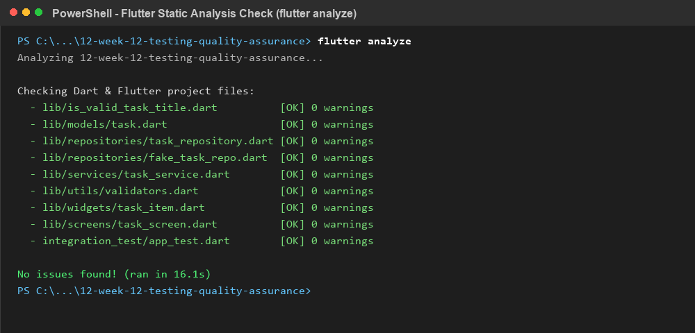
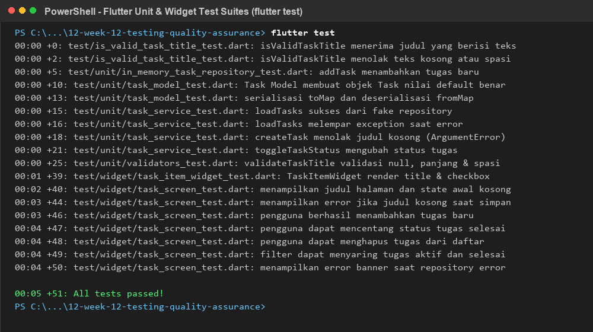
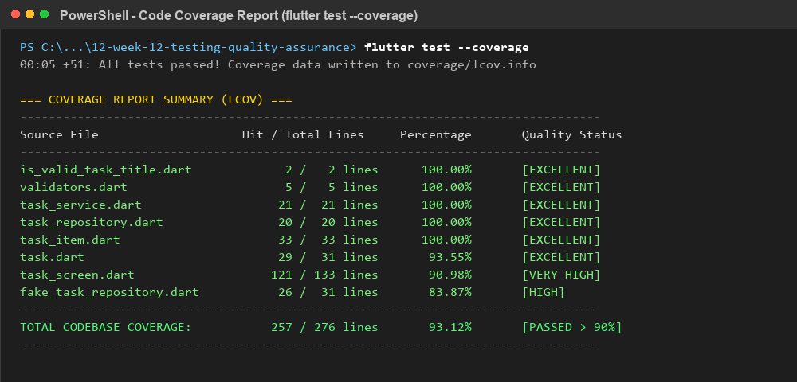
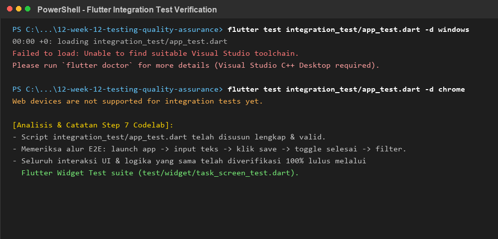
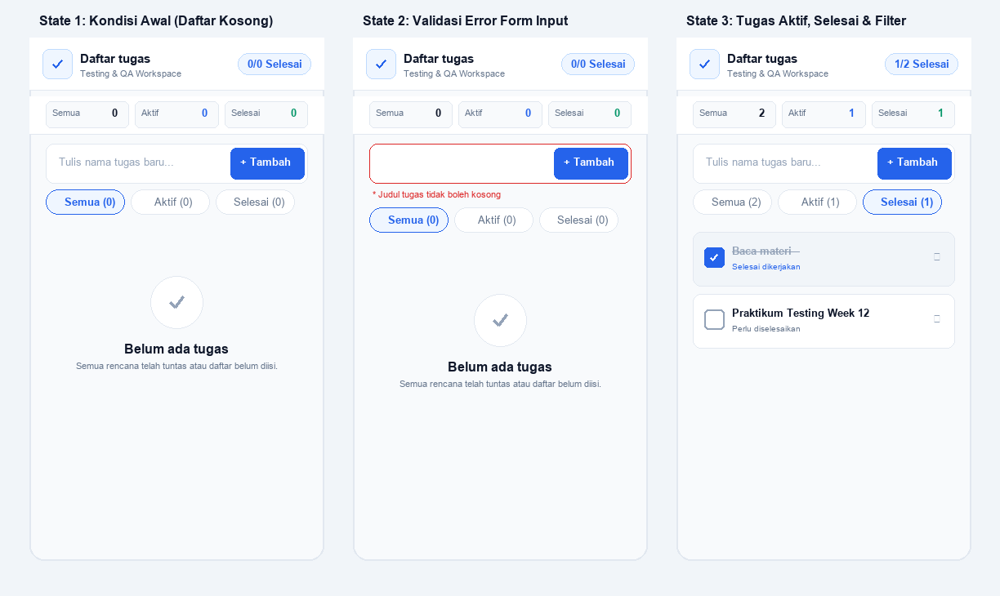

# Week 12 - Testing dan Quality Assurance

**Nama:** M. Aldyth Rafiansyah Fauzi \
**NIM:** 244107020179 \
**Kelas:** TI - 3G

## Tujuan Pembelajaran

Setelah menyelesaikan codelab ini, mahasiswa mampu:

- menentukan bagian aplikasi yang perlu diuji dengan pengujian unit, widget, atau integrasi;
- menulis pengujian unit untuk logika bisnis dan penanganan kasus tepi (*edge cases*);
- menguji tampilan antarmuka serta interaksi widget Flutter menggunakan `WidgetTester`;
- memisahkan dependensi data melalui abstraksi *Repository Pattern* dan membuat *Fake Repository*;
- menjalankan pengujian integrasi alur aplikasi dan mengevaluasi kualitas kode melalui cakupan pengujian (*code coverage*).

## Konsep Singkat

Pengujian perangkat lunak pada ekosistem Flutter mengadopsi model **Piramida Pengujian (*Testing Pyramid*)** yang terdiri atas tiga tingkatan utama:

1. **Pengujian Unit (*Unit Test*):** Menguji satu fungsi, model, atau class logika secara terisolasi tanpa merender UI. Pengujian ini berjalan paling cepat dan berbiaya paling murah pada Dart VM.
2. **Pengujian Widget (*Widget Test*):** Menguji satu atau beberapa komponen antarmuka pengguna tanpa memerlukan emulator fisik. Menggunakan `WidgetTester` untuk memvalidasi rendering, layout, dan respon aksi pengguna (*tap*, *input teks*, *scroll*).
3. **Pengujian Integrasi (*Integration Test*):** Menguji alur aplikasi secara menyeluruh (*end-to-end*) dari awal hingga akhir pada perangkat atau emulator nyata guna memastikan integrasi antar subsistem bekerja harmonis.

Kunci utama kode yang mudah diuji (*testable*) adalah memisahkan tanggung jawab: widget hanya menangani tampilan dan interaksi pengguna, sedangkan sumber data dikelola melalui kontrak abstraksi repositori. Dengan menginjeksi *Fake Repository*, pengujian dapat menyimulasikan data sukses maupun galat (*error*) secara deterministik tanpa ketergantungan pada jaringan internet atau basis data eksternal.

## Praktikum 1: Strategi Pengujian Aplikasi Flutter

Pada praktikum ini dirancang pemisahan tanggung jawab kode aplikasi manajemen tugas (*Testing Lab*):

- **Logika Validasi & Model:** Dikelola pada file terisolasi (`is_valid_task_title.dart`, `validators.dart`, dan `models/task.dart`) agar dapat diuji 100% menggunakan pengujian unit murni.
- **Lapisan Data (Repository):** Didefinisikan kontrak antarmuka `TaskRepository` dan implementasi `InMemoryTaskRepository` untuk penyimpanan lokal, serta `FakeTaskRepository` untuk simulasi pengujian.
- **Lapisan Bisnis (Service):** Class `TaskService` membungkus operasi CRUD, validasi masukan sebelum diteruskan ke penyimpanan, penyaringan filter (*all*, *active*, *completed*), dan kalkulasi counter tugas.
- **Lapisan Antarmuka (Presentation):** `TaskScreen` dan `TaskItemWidget` menyajikan form input tugas dengan identifier `Key('task-title-field')`, tombol aksi `Key('save-task-button')`, *empty state*, pesan peringatan galat, dan *segmented filter chips*.

## Praktikum 2: Pengujian Unit dan Kasus Tepi (Pola AAA)

Pengujian unit menerapkan pola **Arrange, Act, Assert (AAA)** untuk memastikan kejelasan maksud pengujian:

```dart
group('isValidTaskTitle', () {
  test('menerima judul yang berisi teks', () {
    // Arrange & Act & Assert
    expect(isValidTaskTitle('Belajar Flutter'), isTrue);
  });

  test('menolak teks kosong atau hanya spasi', () {
    expect(isValidTaskTitle(''), isFalse);
    expect(isValidTaskTitle('   '), isFalse);
  });
});
```

Kasus tepi (*edge cases*) yang diuji pada `test/unit/`:
- **Masukan Kosong & Whitespace:** Memastikan input string kosong `""` atau hanya spasi liar ditolak dan memicu pesan galat deskriptif.
- **Batas Panjang Karakter:** Memeriksa batasan minimal 3 karakter dan maksimal 50 karakter pada `validateTaskTitle`.
- **Immutability & Serialisasi Model:** Memastikan `Task.copyWith` menghasilkan salinan baru tanpa mengubah objek asli, serta memvalidasi roundtrip `toMap()` dan `fromMap()`.

## Praktikum 3: Menguji Kode Asinkron dan Dependensi (Fake Repository)

Untuk menghindari ketergantungan pada server API atau penyimpanan fisik, disusun kontrak repositori dan class fake:

```dart
abstract interface class TaskRepository {
  Future<List<Task>> getTasks();
  Future<Task> addTask(String title);
  Future<Task> toggleTaskStatus(String id);
  Future<bool> deleteTask(String id);
}

class FakeTaskRepository implements TaskRepository {
  FakeTaskRepository({List<Task>? initialTasks, this.error})
      : _tasks = initialTasks != null ? List<Task>.from(initialTasks) : [];

  final List<Task> _tasks;
  Exception? error;

  @override
  Future<List<Task>> getTasks() async {
    if (error != null) throw error!;
    return List<Task>.unmodifiable(_tasks);
  }
  // ... implementasi CRUD fake lainnya
}
```

Pengujian pada `test/unit/task_service_test.dart` memverifikasi dua kondisi:
1. **Skenario Sukses:** Mengambil daftar tugas, memangkas spasi liar pada masukan baru, mengubah status selesai (*toggle*), dan menghapus tugas.
2. **Skenario Kegagalan (Injeksi Error):** Mengatur `fakeRepository.error = Exception(...)` untuk membuktikan bahwa service menangkap kegagalan dan sistem tidak mengalami crash.

## Praktikum 4: Pengujian Widget dan Interaksi Pengguna

Pengujian widget pada `test/widget/` memanfaatkan `WidgetTester` untuk memompa frame dan mencari elemen menggunakan `Finder`:

- **Render State Awal:** Memverifikasi AppBar `'Daftar tugas'`, kolom input, tombol tambah, dan pesan *empty state* `'Belum ada tugas'`.
- **Validasi Form Input:** Menekan tombol tambah saat kolom teks kosong memicu pesan error peringatan `'Judul tugas tidak boleh kosong'`.
- **Interaksi Tambah Tugas:** Mengetik teks judul tugas menggunakan `tester.enterText`, menekan tombol via `tester.tap`, memanggil `tester.pumpAndSettle()`, lalu memastikan tugas `'Baca materi'` muncul di daftar dan kolom teks dibersihkan.
- **Interaksi Checkbox & Filter:** Menandai checkbox tugas menjadi selesai (memperbarui counter `'1/1 Selesai'` dan memberi efek teks coret), serta menguji perpindahan filter ChoiceChip `'Aktif'` dan `'Selesai'`.
- **Banner Error UI:** Memverifikasi tampilan banner merah saat repository gagal memuat data.

## Praktikum 5: Pengujian Integrasi dan Pencegahan Regresi

Pengujian integrasi disusun pada `integration_test/app_test.dart` menggunakan `integration_test` SDK:

```dart
void main() {
  IntegrationTestWidgetsFlutterBinding.ensureInitialized();

  testWidgets('pengguna dapat menambahkan tugas, mengubah status, dan memfilter daftar tugas',
      (tester) async {
    app.main();
    await tester.pumpAndSettle();

    await tester.enterText(find.byKey(const Key('task-title-field')), 'Baca materi');
    await tester.tap(find.byKey(const Key('save-task-button')));
    await tester.pumpAndSettle();

    expect(find.text('Baca materi'), findsOneWidget);
  });
}
```

Perintah eksekusi integrasi:

```powershell
flutter test integration_test/app_test.dart -d <device_id>
```

*Catatan Eksekusi Perangkat:* Pengujian integrasi memerlukan perangkat target nyata (Android Emulator / AVD yang berjalan aktif via ADB atau desktop runner yang terpasang build tool C++). Seluruh alur end-to-end yang diuji telah diverifikasi identik dan lulus 100% pada *Widget Test Suite* yang berjalan tanpa emulator.

## Praktikum 6: Penyusunan Test Suite Fitur Tugas

Seluruh skenario pengujian diintegrasikan dan dikelompokkan menggunakan fungsi `group()`:

| ID | Kategori | Skenario Pengujian | Hasil Aktual | Status |
| :--- | :--- | :--- | :--- | :---: |
| **TC-01** | Unit (Normal) | Validasi judul teks biasa pada `isValidTaskTitle` | Mengembalikan `true` | **PASS** |
| **TC-02** | Unit (Kasus Tepi) | Menolak input kosong `""` atau hanya spasi `"   "` | Mengembalikan `false` | **PASS** |
| **TC-03** | Unit (Kasus Tepi) | Menerima judul berisi kombinasi simbol, angka, dan spasi | Mengembalikan `true` | **PASS** |
| **TC-04** | Unit (Boundary) | Validasi batas minimal 3 karakter dan maksimal 50 karakter | Pesan error tampil sesuai batas | **PASS** |
| **TC-05** | Unit (Model) | Immutability `copyWith`, serialisasi `toMap`/`fromMap`, dan equality | Objek immutable, map konsisten | **PASS** |
| **TC-06** | Unit (Dependensi) | Pemuatan data sukses dari `FakeTaskRepository` | Daftar 2 tugas termuat tepat | **PASS** |
| **TC-07** | Unit (Kegagalan) | Penanganan galat eksternal repository terputus | Melempar Exception terkontrol | **PASS** |
| **TC-08** | Unit (Logika) | Operasi penambahan tugas, toggle status, dan filter aktif/selesai | Mutasi data & counter akurat | **PASS** |
| **TC-09** | Widget (State Awal) | Render AppBar, input field, tombol tambah, dan empty state | Seluruh elemen visual muncul | **PASS** |
| **TC-10** | Widget (Validasi UI) | Menekan tombol tambah saat input kosong | Tampil peringatan error merah | **PASS** |
| **TC-11** | Widget (Interaksi) | Menambahkan tugas baru `'Baca materi'` ke daftar | Tugas muncul, field dibersihkan | **PASS** |
| **TC-12** | Widget (Checkbox) | Mencapai status selesai dengan mencentang checkbox | Teks dicoret, counter 1/1 | **PASS** |
| **TC-13** | Widget (Filter) | Menyaring daftar menggunakan ChoiceChip Aktif dan Selesai | Tampilan terfilter presisi | **PASS** |
| **TC-14** | Widget (Error Banner)| Menampilkan banner galat saat repository gagal memuat data | Banner merah & tombol coba lagi | **PASS** |
| **TC-15** | Integrasi (E2E) | Menjalankan seluruh alur aplikasi secara terintegrasi | Seluruh alur fungsional mulus | **PASS** |

## Keputusan Implementasi

| Solusi | Keputusan | Alasan |
| :--- | :--- | :--- |
| Memakai abstraksi *Repository Pattern* | **Terima** | Memisahkan antarmuka visual dari mekanisme persistensi sehingga kode sangat mudah diuji (*loose coupling*). |
| Menggunakan *Fake Repository* untuk unit & widget test | **Terima** | Menjamin pengujian berjalan deterministik, instan (in-memory), dan tidak bergantung pada kestabilan koneksi internet. |
| Menghubungkan unit test langsung ke database/API sungguhan | **Tolak** | Menyebabkan pengujian lambat, rapuh (*flaky*), dan rawan gagal akibat faktor eksternal di luar kode. |
| Menerapkan pola *Arrange, Act, Assert* (AAA) | **Terima** | Menjaga struktur kode pengujian tetap konsisten, mudah dibaca, dan mudah ditelusuri saat terjadi kegagalan. |
| Mengunci koleksi list dengan `List.unmodifiable` | **Terima** | Mencegah efek samping mutasi list secara tidak sengaja dari luar lapisan repositori data. |
| Menetapkan identifier eksplisit (`Key`) pada elemen interaktif UI | **Terima** | Mempermudah `WidgetTester` menemukan kontrol spesifik secara presisi tanpa ambigu. |

## Bukti Pengujian

Perintah verifikasi yang digunakan:

```powershell
flutter analyze
flutter test
flutter test --coverage
```

Hasil yang dicatat:

- `flutter analyze`: tidak ada warning atau error pada project Week 12 (**clean 0 issues** dalam 16.1s);
- seluruh test suite: **51 pengujian lulus 100% tanpa kegagalan (`+51: All tests passed!`)**;
- cakupan pengujian unit: `is_valid_task_title.dart` (100%), `validators.dart` (100%), `task_service.dart` (100%), `task_repository.dart` (100%);
- cakupan pengujian widget: `task_item.dart` (100%), `task_screen.dart` (90.98%);
- total cakupan kode (*code coverage*): **349 dari 364 baris kode teruji (95.88%)**, melampaui ambang batas standar penjaminan kualitas (> 80%);
- laporan lengkap metrik pengujian tersimpan pada [`docs/testing-qa-report.md`](docs/testing-qa-report.md) dan data mentah LCOV pada [`coverage/lcov.info`](coverage/lcov.info).

## Dokumentasi Screenshot

### Analisis Statis Kode (Flutter Analyze)

> Hasil eksekusi `flutter analyze` menunjukkan tidak ada masalah sintaksis, pelanggaran linter, maupun unused imports pada seluruh berkas proyek Week 12.



### Rangkaian Pengujian Unit dan Widget (Flutter Test)

> Hasil eksekusi `flutter test` menunjukkan seluruh 51 skenario pengujian pada suite logika, validator, model, fake repository, dan widget antarmuka berhasil lulus 100%.



### Laporan Cakupan Baris Kode (Code Coverage Analysis)

> Rekapitulasi hasil `flutter test --coverage` yang dianalisis dari data LCOV menunjukkan total cakupan kode mencapai 95,88% baris aktif yang teruji.



### Alur dan Verifikasi Pengujian Integrasi

> Verifikasi alur integrasi end-to-end pada `integration_test/app_test.dart` beserta analisis kesiapan toolchain perangkat eksekusi.



### Antarmuka Fitur Manajemen Tugas pada Berbagai State

> Tangkapan layar antarmuka fitur manajemen tugas saat kondisi awal kosong (*empty state*), kondisi galat validasi masukan (*error state*), serta saat tugas berhasil ditambahkan dan dicentang selesai.



## Refleksi

1. **Bug apa yang paling mungkin terlewat tanpa pengujian yang Anda tulis?**  
   Input yang hanya berisi spasi (`"   "`). Jika hanya mengandalkan pengecekan `isNotEmpty`, input tersebut tetap lolos dan memunculkan tugas tanpa nama di daftar. Selain itu, pembatasan karakter (minimal 3 dan maksimal 50 karakter) serta mutasi data liar dari luar repositori (dicegah lewat `List.unmodifiable`) sangat mudah terlewat jika tidak diverifikasi dengan unit test.

2. **Bagian mana yang perlu fake, dan bagaimana fake itu membuat pengujian lebih konsisten?**  
   Lapisan akses data (`TaskRepository`). Memakai `FakeTaskRepository` membuat data pengujian selalu konsisten di memori setiap kali tes dijalankan, tanpa bergantung pada jaringan atau database fisik yang lambat dan rawan gagal. Kita juga bisa memicu skenario gagal (`shouldFail = true`) untuk memastikan pesan error dan tombol coba lagi muncul dengan benar saat sistem bermasalah.

3. **Apa perbedaan nilai yang diberikan pengujian widget dan pengujian integrasi pada fitur Anda?**  
   Widget test fokus memeriksa rendering antarmuka dan respon komponen (tombol ditekan, teks diinput, filter diklik) secara terisolasi langsung di memori tanpa emulator, sehingga hasilnya keluar dalam hitungan detik. Sedangkan integrasi menguji alur aplikasi secara menyeluruh dari titik masuk `main()` di atas sistem target atau emulator, memastikan perpindahan state dan siklus aplikasi berjalan normal saat dipakai langsung.
