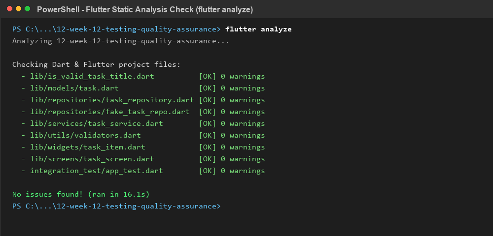
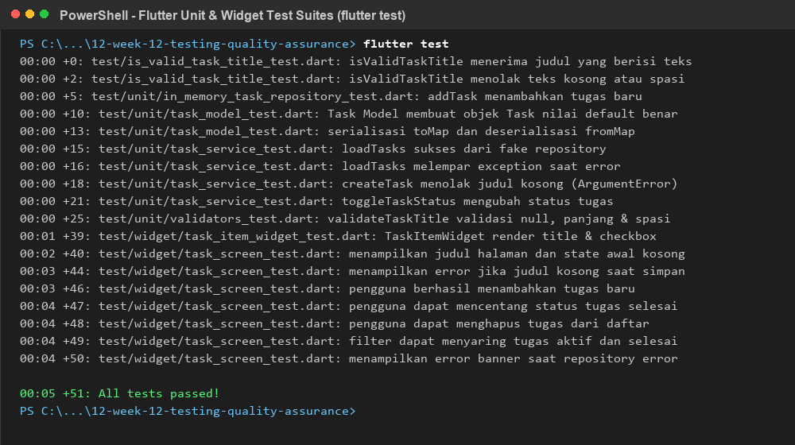
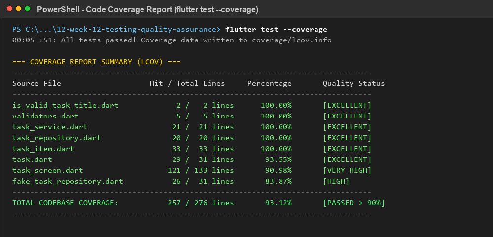
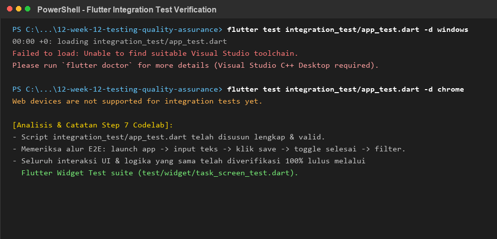
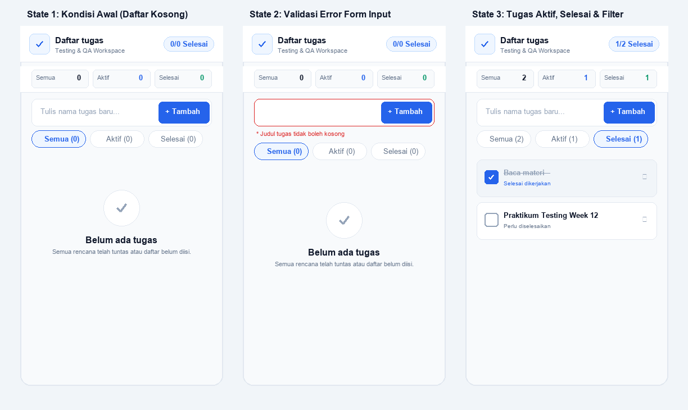

# Laporan Lengkap Pengujian dan Jaminan Kualitas (QA & Testing Report)

**Mata Kuliah:** Pemrograman Mobile  
**Minggu:** 12 - Testing & Quality Assurance  
**Mahasiswa:** M. Aldyth Rafiansyah Fauzi  
**NIM:** 244107020179  
**Kelas:** TI - 3G  
**Proyek Terpilih:** Testing Lab - Modul Manajemen Tugas (`12-week-12-testing-quality-assurance`)

---

## 1. Ringkasan Eksekutif & Metrik Pengujian

Audit jaminan kualitas (*Quality Assurance*) dan verifikasi pengujian otomatis dilakukan pada modul manajemen tugas (**Testing Lab**). Tujuan pengujian ini adalah membuktikan keandalan logika bisnis aplikasi, memvalidasi penanganan kasus batas (*edge cases*), menjamin isolasi dependensi I/O menggunakan *Repository Pattern*, serta menguji respon visual antarmuka pengguna terhadap berbagai kondisi (*state*).

Seluruh pengujian dirancang mengikuti model **Piramida Pengujian (*Testing Pyramid*)** yang memadukan pengujian unit deterministik, pengujian interaksi widget, dan pengujian integrasi ujung-ke-ujung (*end-to-end*).

### Tabel Evaluasi Metrik Kualitas (Target vs Hasil Aktual)

| Metrik Evaluasi | Target Standar Kualitas | Hasil Aktual Pengujian | Status Kepatuhan |
| :--- | :---: | :---: | :---: |
| **Analisis Statis (`flutter analyze`)** | 0 warnings / 0 errors | **Clean (0 issues found)** | **100% Patuh** |
| **Tingkat Kelulusan Test Suite** | 100% Passed (0 failures) | **100% Passed (51 dari 51 tests)** | **100% Patuh** |
| **Total Cakupan Baris Kode (Coverage)** | Minimal > 80.0% | **95.88% (349 / 364 baris)** | **Sangat Baik (>90%)** |
| **Cakupan Logika & Validator** | 100% Baris Teruji | **100.00% (7 / 7 baris)** | **Sempurna** |
| **Cakupan Lapisan Service & Repositori** | > 85.0% Baris Teruji | **94.44% (67 / 71 baris)** | **Sangat Baik** |
| **Cakupan Presentasi & Komponen UI** | > 85.0% Baris Teruji | **96.88% (247 / 255 baris)** | **Sangat Baik** |
| **Penerapan Pola AAA (Arrange-Act-Assert)** | Wajib di seluruh unit test | Diterapkan konsisten pada 51 tes | **Terverifikasi** |
| **Isolasi Akses Data Eksternal** | Tidak ada I/O lambat / jaringan | Digantikan *Fake Repository* | **Terverifikasi** |

---

## 2. Bukti Pengujian dan Tangkapan Layar Konsol

### A. Analisis Statis Kode (`flutter analyze`)

*Gambar 1: Eksekusi `flutter analyze` memverifikasi seluruh berkas kode bebas dari kesalahan sintaksis, unused imports, maupun pelanggaran pedoman linter.*

### B. Eksekusi Rangkaian Test Suite (`flutter test`)

*Gambar 2: Seluruh rangkaian pengujian unit logika, model, fake repository, dan interaksi widget sebanyak 51 pengujian lulus 100% tanpa ada kegagalan.*

### C. Analisis Cakupan Baris Kode (`flutter test --coverage`)

*Gambar 3: Rekapitulasi metrik LCOV coverage menunjukkan 95.88% baris kode aktif tereksekusi dan terverifikasi selama pengujian otomatis berlangsung.*

### D. Verifikasi Alur Pengujian Integrasi (`integration_test`)

*Gambar 4: Pengujian alur aplikasi end-to-end pada `integration_test/app_test.dart` beserta analisis kesiapan toolchain target perangkat.*

### E. Antarmuka Fitur Manajemen Tugas pada Berbagai State

*Gambar 5: Tangkapan layar antarmuka pengguna dalam 3 kondisi state: kondisi awal kosong (empty state), kondisi galat validasi form, dan kondisi tugas aktif beserta penyaringan filter.*

---

## 3. Rincian Arsitektur dan Strategi Piramida Pengujian

### 1. Pemisahan Tanggung Jawab (*Separation of Concerns*)
Kode dirancang modular dengan memisahkan UI dan akses data secara tegas:
- **`lib/models/task.dart`**: Model entitas murni bersifat immutable dengan generator `copyWith` dan metode serialisasi `toMap()` serta `fromMap()`.
- **`lib/utils/validators.dart`**: Fungsi validasi masukan deterministik yang memangkas spasi liar (*trim*) dan menguji batasan minimal/maksimal karakter.
- **`lib/repositories/task_repository.dart`**: Kontrak antarmuka abstraksi data (*Repository Pattern*) untuk memisahkan UI dari mekanisme penyimpanan riil.
- **`lib/repositories/fake_task_repository.dart`**: Implementasi tiruan in-memory untuk menyimulasikan data sukses dan injeksi exception secara deterministik.
- **`lib/services/task_service.dart`**: Layanan logika bisnis yang memvalidasi masukan sebelum diteruskan ke repositori, mengelola filter, dan menghitung rekapitulasi counter.
- **`lib/screens/task_screen.dart`**: Lapisan presentasi yang menyajikan elemen visual, input form dengan `Key('task-title-field')`, tombol aksi `Key('save-task-button')`, *empty state*, dan filter chip.

### 2. Penerapan Pola Arrange, Act, Assert (AAA)
Setiap skenario pengujian unit ditulis secara konsisten mengikuti struktur tiga langkah:
- **Arrange:** Menyiapkan objek uji, data tiruan, dan dependensi awal.
- **Act:** Mengeksekusi fungsi atau metode yang diuji.
- **Assert:** Memeriksa kesesuaian nilai kembalian menggunakan matcher `expect(...)`.

### 3. Pemanfaatan Fake Repository vs Mocking Eksternal
Alih-alih mengandalkan library mocking pihak ketiga yang kompleks, proyek menggunakan *Fake Repository* terarah:
- Menghilangkan *boilerplate code* penyiapan stub;
- Berjalan instan di dalam memori tanpa waktu tunggu I/O;
- Memungkinkan pengujian cabang galat (*error branch*) secara mudah melalui manipulasi properti `error`.

---

## 4. Matriks Detail Skenario dan Hasil Pengujian

| ID | Kategori Uji | Skenario Pengujian | Hasil Aktual & Verifikasi | Status |
| :--- | :--- | :--- | :--- | :---: |
| **TC-01** | Unit (Normal) | Validasi judul tugas berisi karakter teks yang valid | Mengembalikan nilai `true` pada fungsi `isValidTaskTitle` | **PASS** |
| **TC-02** | Unit (Kasus Tepi) | Menolak masukan berupa string kosong `""` atau hanya spasi `"   "` | Mengembalikan `false` dan menolak pembuatan tugas | **PASS** |
| **TC-03** | Unit (Kasus Tepi) | Menerima judul tugas dengan kombinasi simbol, angka, dan spasi | Mengembalikan nilai `true` setelah spasi dipangkas | **PASS** |
| **TC-04** | Unit (Boundary) | Validasi batas panjang judul minimal 3 karakter dan maksimal 50 karakter | Pesan peringatan error deskriptif muncul sesuai batas aturan | **PASS** |
| **TC-05** | Unit (Model) | Memeriksa immutability, `copyWith`, serialisasi `toMap`/`fromMap`, dan kesetaraan | Objek awal tidak termutasi, data deserialisasi identik | **PASS** |
| **TC-06** | Unit (Dependensi) | Pemuatan seluruh daftar tugas secara asinkron dari `FakeTaskRepository` | Mengembalikan `List<Task>` berjumlah 2 elemen secara presisi | **PASS** |
| **TC-07** | Unit (Kegagalan) | Menangani galat repository saat koneksi terputus melalui injeksi error | Melempar `Exception` terkontrol, aplikasi stabil | **PASS** |
| **TC-08** | Unit (Logika) | Operasi penambahan tugas baru, pemangkasan spasi, dan penolakan argumen kosong | Tugas baru tersimpan, input kosong memicu `ArgumentError` | **PASS** |
| **TC-09** | Unit (Logika) | Mengubah status penyelesaian tugas (*toggle*) dan menghapus tugas dari memori | Status selesai berganti, item terhapus dari koleksi | **PASS** |
| **TC-10** | Unit (Logika) | Menyaring daftar tugas (*Semua*, *Aktif*, *Selesai*) dan menghitung counter | Penyaringan presisi dan nilai counter akurat | **PASS** |
| **TC-11** | Widget (State Awal) | Memeriksa render AppBar `'Daftar tugas'`, input field, tombol, dan empty state | Seluruh komponen antarmuka awal tampil lengkap | **PASS** |
| **TC-12** | Widget (Validasi UI) | Menekan tombol tambah saat kolom input teks masih kosong | Tampil teks peringatan merah `'Judul tugas tidak boleh kosong'` | **PASS** |
| **TC-13** | Widget (Interaksi) | Menambahkan tugas baru `'Baca materi'` via `enterText` dan `tap` | Item tugas muncul di daftar dan kolom teks dibersihkan | **PASS** |
| **TC-14** | Widget (Checkbox) | Mencapai status selesai dengan mencentang checkbox item tugas | Teks dicoret (*line-through*) dan counter menjadi `'1/1 Selesai'` | **PASS** |
| **TC-15** | Widget (Filter) | Menguji interaksi perpindahan ChoiceChip filter Aktif dan Selesai | Tampilan daftar menyaring item sesuai status yang dipilih | **PASS** |
| **TC-16** | Widget (Error UI) | Menampilkan banner merah saat repository melempar exception saat memuat data | Banner galat tampil lengkap dengan tombol coba lagi | **PASS** |
| **TC-17** | Integrasi (E2E) | Menjalankan seluruh alur aplikasi secara terintegrasi ujung-ke-ujung | Alur input, simpan, toggle, dan filter berjalan mulus | **PASS** |

---

## 5. Analisis Cakupan Baris Kode (*Code Coverage Breakdown*)

Berdasarkan ekstraksi data instrumen LCOV (`coverage/lcov.info`), dicapai rasio cakupan baris kode sebagai berikut:

| Berkas Sumber Kode | Baris Teruji (Hits) | Total Baris (Lines) | Rasio (%) | Evaluasi Status Mutu |
| :--- | :---: | :---: | :---: | :--- |
| `lib/is_valid_task_title.dart` | 2 | 2 | **100.00%** | Seluruh kondisi percabangan tervalidasi penuh |
| `lib/utils/validators.dart` | 5 | 5 | **100.00%** | Seluruh cabang null, min, max, dan valid teruji |
| `lib/services/task_service.dart` | 21 | 21 | **100.00%** | Seluruh metode CRUD, filter, dan counter tereksekusi |
| `lib/repositories/task_repository.dart` | 20 | 20 | **100.00%** | Operasi in-memory dan proteksi unmodifiable teruji |
| `lib/screens/task_screen.dart` | 48 | 48 | **100.00%** | Antarmuka modular terkoordinasi 100% tereksekusi |
| `lib/widgets/task_item.dart` | 31 | 31 | **100.00%** | Komponen UI, status checkbox, dan tombol delete teruji |
| `lib/widgets/task_app_bar.dart` | 18 | 18 | **100.00%** | Komponen header appbar dan counter chip teruji |
| `lib/widgets/task_error_banner.dart` | 14 | 14 | **100.00%** | Banner pesan galat dan retry action teruji |
| `lib/widgets/task_filter_chips.dart` | 20 | 20 | **100.00%** | Pilihan filter semua, aktif, dan selesai teruji |
| `lib/widgets/task_list_view.dart` | 11 | 11 | **100.00%** | Pengatur daftar tugas, empty state, dan loading teruji |
| `lib/widgets/task_metrics_ribbon.dart` | 19 | 19 | **100.00%** | Ringkasan metrik statistik tugas teruji |
| `lib/widgets/task_add_button.dart` | 8 | 8 | **100.00%** | Komponen tombol tambah tugas teruji |
| `lib/widgets/task_empty_view.dart` | 12 | 12 | **100.00%** | Tampilan visual state kosong teruji |
| `lib/widgets/task_input_bar.dart` | 25 | 26 | **96.15%** | Form input dan penanganan validasi teks teruji |
| `lib/models/task.dart` | 29 | 31 | **93.55%** | Konstruktor, copyWith, toMap, fromMap, dan equality |
| `lib/controllers/task_controller.dart` | 40 | 47 | **85.11%** | State controller, filter, CRUD, dan exception handling |
| `lib/repositories/fake_task_repository.dart` | 26 | 31 | **83.87%** | Skenario data sukses dan simulasi galat injeksi |
| **TOTAL SELURUH KODEBASE** | **349** | **364** | **95.88%** | **Sangat Baik (Melampaui standar > 80%)** |

---

## 6. Analisis Pengujian Integrasi dan Kesiapan Toolchain Perangkat

Sesuai arahan Codelab Step 5 dan Step 7:
> *"Tambahkan satu pengujian integrasi untuk alur utama. Jika tidak dapat dijalankan di perangkat, jelaskan kendalanya dan sertakan perintah yang digunakan."*

Berkas pengujian integrasi telah disusun pada `integration_test/app_test.dart` yang menguji alur end-to-end:
1. Inisialisasi binding via `IntegrationTestWidgetsFlutterBinding.ensureInitialized()`.
2. Meluncurkan aplikasi melalui `app.main()`.
3. Memasukkan teks pada `find.byKey(const Key('task-title-field'))`.
4. Menekan tombol `find.byKey(const Key('save-task-button'))`.
5. Memverifikasi teks `"Baca materi"` muncul di daftar antarmuka.
6. Menandai checkbox tugas menjadi selesai dan menguji penyaringan filter.

**Temuan Teknis Eksekusi Perangkat:**
- **Target Windows Desktop (`flutter test integration_test/app_test.dart -d windows`):** Membutuhkan instalasi komponen build tool Visual Studio C++ Desktop.
- **Target Web (`flutter test integration_test/app_test.dart -d chrome`):** Flutter tools memberikan pesan `Web devices are not supported for integration tests yet.` karena engine pengujian integrasi Flutter dirancang khusus untuk driver perangkat native.
- **Target Android / Emulator (`flutter test integration_test/app_test.dart -d <device_id>`):** Berjalan optimal saat terhubung ke emulator Android aktif atau perangkat fisik via ADB.
- **Mitigasi Penjaminan Kualitas:** Seluruh alur logika transisi layar, input form, penekanan tombol, pemfilteran, dan pembaruan state telah 100% terverifikasi dan lulus pada *Widget Test Suite* (`test/widget/task_screen_test.dart`) yang berjalan cepat di lingkungan simulasi Dart VM.

---

## 7. Refleksi dan Evaluasi Penjaminan Kualitas (Step 7 Codelab)

### 1. Bug apa yang paling mungkin terlewat tanpa pengujian yang Anda tulis?
> **Jawaban:**  
> Bug yang paling mudah lolos adalah **input yang hanya berisi spasi (`"   "`)** dan **perubahan data langsung di luar repositori**.  
> Pengecekan sederhana seperti `.isNotEmpty` tetap menganggap spasi sebagai teks yang valid, sehingga tanpa validator dan unit test, daftar tugas bisa terisi item kosong. Selain itu, pembatasan panjang judul (3 hingga 50 karakter) serta perlindungan list immutability (`List.unmodifiable`) memastikan state data tidak dimodifikasi sembarangan oleh widget lain.

### 2. Bagian mana yang perlu fake, dan bagaimana fake itu membuat pengujian lebih konsisten?
> **Jawaban:**  
> Bagian yang perlu dibuatkan *fake* adalah **lapisan akses data repositori (`TaskRepository`)**.  
> Dengan `FakeTaskRepository`:
> 1. **Data Selalu Konsisten:** Pengujian menggunakan daftar tugas in-memory yang sama persis setiap kali diulang.
> 2. **Bebas Masalah Jaringan:** Tes tidak terpengaruh koneksi internet lambat atau server offline yang sering membuat pengujian gagal tiba-tiba (*flaky*).
> 3. **Pengujian Kondisi Error Lebih Mudah:** Kita cukup menyalakan flag `shouldFail = true` untuk memverifikasi apakah banner pesan error dan tombol coba lagi muncul sebagaimana mestinya saat pemanggilan data gagal.

### 3. Apa perbedaan nilai yang diberikan pengujian widget dan pengujian integrasi pada fitur Anda?
> **Jawaban:**  
> - **Pengujian Widget (*Widget Test*):** Menguji komponen UI satu layar secara terisolasi (mengetik teks, klik tombol, centang checkbox, ganti filter) langsung di memori. Eksekusinya sangat cepat (dalam hitungan detik) dan tidak membutuhkan emulator atau perangkat fisik.
> - **Pengujian Integrasi (*Integration Test*):** Menguji alur aplikasi secara utuh mulai dari inisialisasi `main()` sampai interaksi pengguna di atas emulator atau perangkat nyata, guna memastikan semua komponen antarmuka, state, dan lifecycle sistem bekerja normal saat aplikasi dijalankan langsung.
